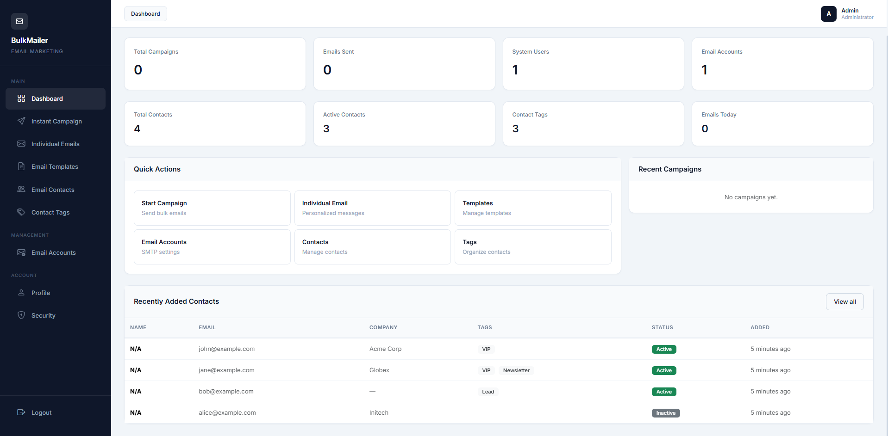
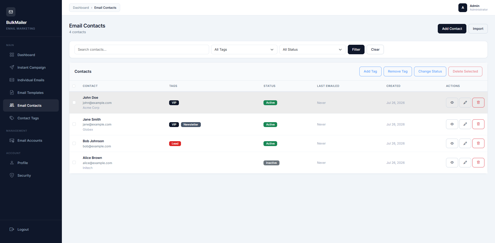
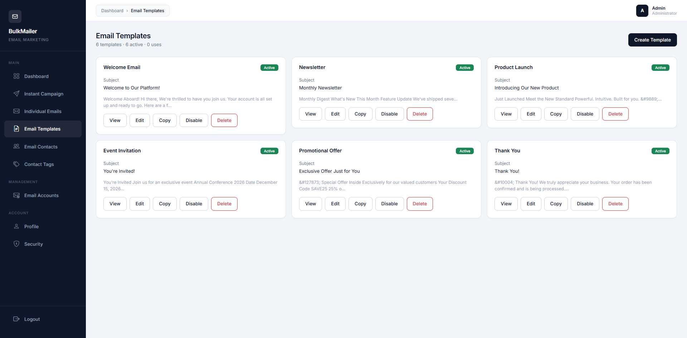
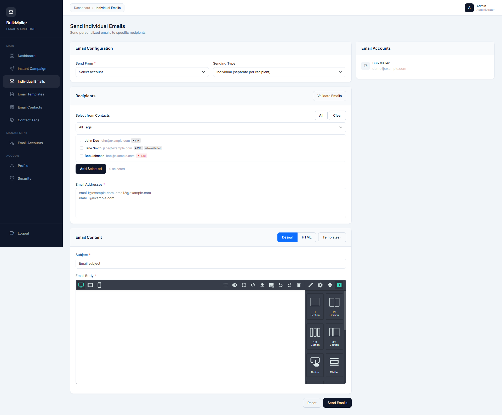
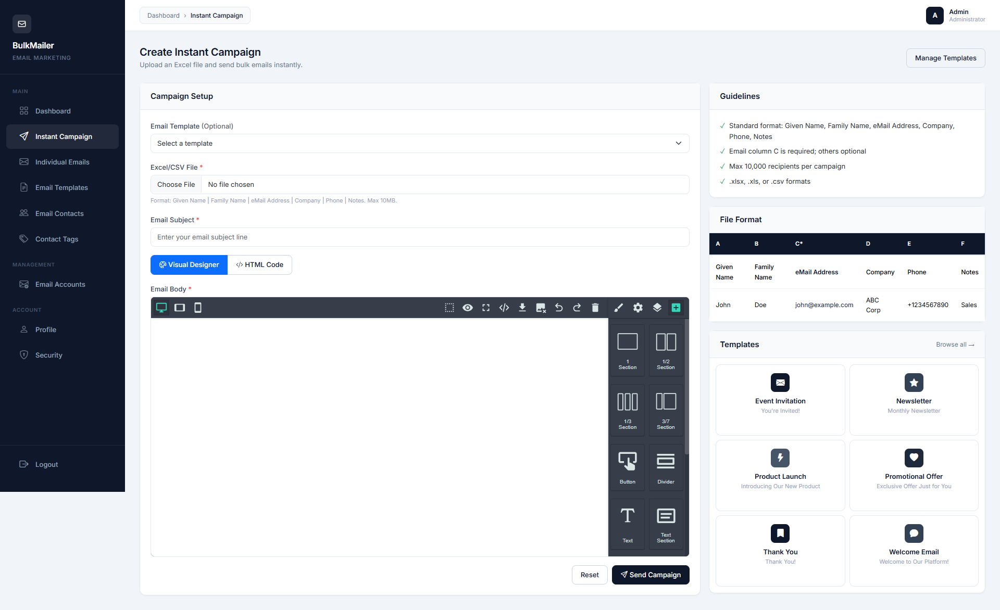
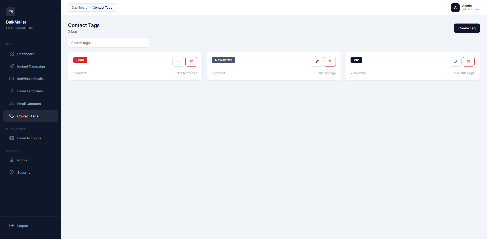
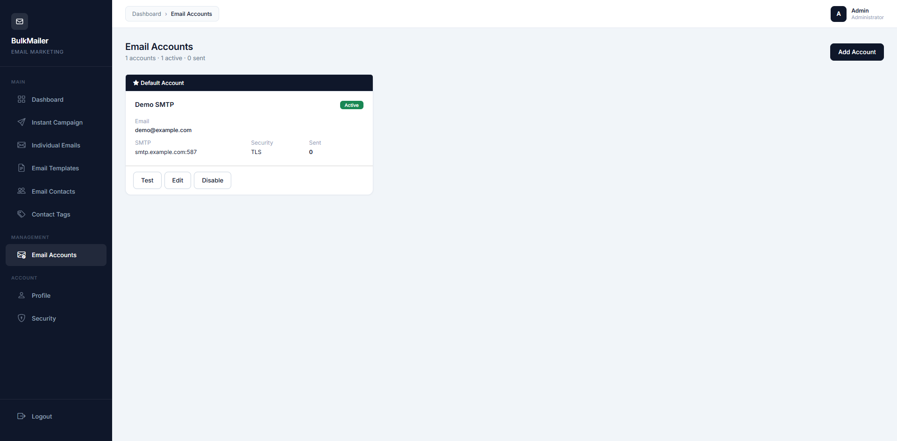
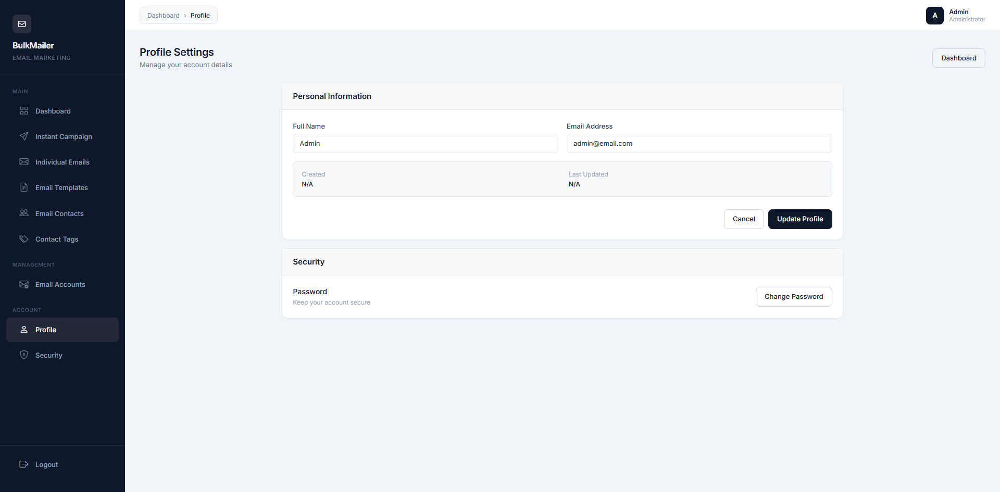
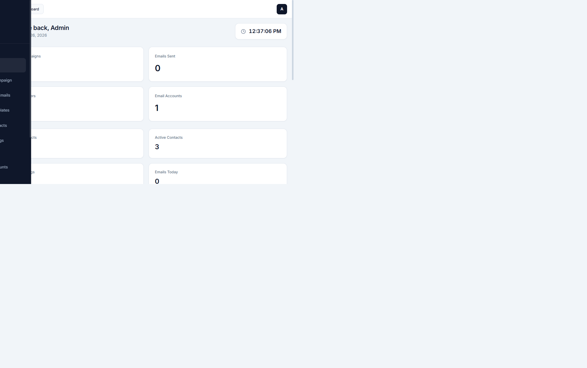

<div align="center">
  
<svg width="120" height="120" viewBox="0 0 120 120">
  <defs>
    <linearGradient id="logoGradient" x1="0%" y1="0%" x2="100%" y2="100%">
      <stop offset="0%" style="stop-color:#667eea;stop-opacity:1" />
      <stop offset="100%" style="stop-color:#764ba2;stop-opacity:1" />
    </linearGradient>
  </defs>
  <circle cx="60" cy="60" r="55" fill="url(#logoGradient)"/>
  <rect x="30" y="42" width="60" height="36" rx="6" fill="white" opacity="0.95"/>
  <path d="M30 48 L60 65 L90 48" stroke="url(#logoGradient)" stroke-width="2" fill="none" stroke-linecap="round"/>
  <circle cx="85" cy="35" r="2" fill="white" opacity="0.8"/>
  <circle cx="90" cy="30" r="1.5" fill="white" opacity="0.6"/>
  <circle cx="95" cy="35" r="1" fill="white" opacity="0.4"/>
</svg>
  
  <h1>🚀 Bulk Email Sender</h1>
  
  <p><strong>Professional Laravel 13 email marketing &amp; bulk sending solution with rich HTML editor, realtime campaign tracker, and cPanel/VPS support</strong></p>
  
  <p>
    
    
    
    
  </p>
  
  <p>
    
    
  </p>
</div>

---

## ✨ Features

**Highlights:**
- ⚡ **Laravel 13 & PHP 8.3–8.5** — Modern framework with strict cache serialization and origin-aware CSRF protection
- 📡 **Realtime Campaign Tracker** — Live dashboard widget, per-recipient status, throughput/ETA, and one-click failed recipient retries
- 🛠️ **Queue Failures Dashboard** — Inspect, sync, retry, and purge failed jobs directly from the UI
- 🏷️ **Dynamic Keyword Personalization** — Admin-defined `[name]`, `[company_name]`, `[phone]`, etc. with editor picker and preview
- 🚫 **Unsubscribe Suppression List** — RFC 8058 one-click `List-Unsubscribe` headers and signed footer unsubscribe links
- 🚦 **SMTP Throttling & Preflight Checks** — Per-account rate limiting (`SMTP_RATE_PER_MINUTE`), staggered delays, and pre-send SMTP/queue verification
- 🖥️ **cPanel & Dedicated Server Ready** — No Node.js/Redis required on cPanel (`schedule.php` file-based cron), scales cleanly to Supervisor + Redis on VPS/dedicated servers
- 🎨 **Minimal 2-Color UI & TinyMCE Editor** — Responsive Bootstrap 5 interface with 6 modern HTML email templates
- 🔍 **Smart Contacts & CSV Import/Export** — Server-side search, tag/status filters, bulk select (up to 10k), and filtered/selected CSV export

**Core Features:**
- ✅ Bulk email campaigns & individual email sending
- ✅ Contact management with tagging system
- ✅ Excel/CSV import (`maatwebsite/excel` 4.x) and CSV export
- ✅ Multi-SMTP account management with encrypted credentials
- ✅ Real-time delivery tracking and automatic retries

---

## 🛠️ Prerequisites

- **PHP:** `8.3+` (supports PHP `8.3`, `8.4`, and `8.5`)
- **PHP Extensions:** `pdo_mysql`, `mbstring`, `xml`, `zip`, `fileinfo`, `gd`, `openssl`, `curl`
- **Composer:** `2.x`
- **Database:** MySQL `5.7+` / `8.0+` or MariaDB `10.3+`
- **SMTP Server:** Any SMTP provider (Gmail, Amazon SES, SendGrid, Mailgun, Postmark, Brevo, or host SMTP)
- **Node.js:** *Not required* in production (all frontend assets load via CDN)

---

## ⚡ Quick Start (Local Development)

1. **Clone and install dependencies**
   ```bash
   git clone https://github.com/arafat-web/Bulk-Email-Sender.git
   cd Bulk-Email-Sender
   composer install
   cp .env.example .env
   php artisan key:generate
   ```

2. **Configure database & queue in `.env`**
   ```env
   DB_CONNECTION=mysql
   DB_HOST=127.0.0.1
   DB_PORT=3306
   DB_DATABASE=bes
   DB_USERNAME=root
   DB_PASSWORD=

   QUEUE_CONNECTION=database
   CACHE_DRIVER=database
   SESSION_DRIVER=database
   LOG_CHANNEL=daily
   SMTP_RATE_PER_MINUTE=6
   TINYMCE_API_KEY=no-api-key
   ```

3. **Run migrations & seeders**
   ```bash
   php artisan migrate --seed
   ```

4. **Start the app and queue worker**
   ```bash
   php artisan serve
   # In a separate terminal:
   php artisan queue:work --queue=emails,default --tries=3 --timeout=120 --sleep=3
   ```

**Default Login:** `admin@email.com` / `12345678` *(change immediately after first login)*

---

## 🌐 Deployment Guide: cPanel (Shared Hosting)

Bulk Email Sender runs smoothly on cPanel with **no Node.js, no Redis, and no Supervisor daemon**.

### 1. Select PHP Version & Extensions
In **cPanel → Select PHP Version** (or **MultiPHP Manager**):
- Choose **PHP 8.3**, **8.4**, or **8.5**.
- Enable extensions: `pdo_mysql`, `mbstring`, `xml`, `zip`, `fileinfo`, `gd`, `curl`, `openssl`.

### 2. Upload the Project & Set Document Root
- Upload or `git clone` the project **outside** `public_html` (recommended, e.g. `/home/USER/bulk-email-sender`) and point your domain/subdomain's **Document Root** to `/home/USER/bulk-email-sender/public`.
- *Alternative (main domain locked to `public_html`):* Upload the app to `/home/USER/bulk-email-sender` and copy the contents of `public/` into `/home/USER/public_html/`, updating the two `require` paths in `public_html/index.php` to point to `../bulk-email-sender/vendor/autoload.php` and `../bulk-email-sender/bootstrap/app.php`. Never expose `.env` or `storage/` inside a web-accessible directory.

### 3. Create Database & Configure `.env`
In **cPanel → MySQL Databases**, create a database and user, then copy `.env.example` to `.env` and update for production:
```env
APP_ENV=production
APP_DEBUG=false
APP_URL=https://your-domain.com
SESSION_SECURE_COOKIE=true

LOG_CHANNEL=daily
DB_CONNECTION=mysql
DB_HOST=127.0.0.1
DB_PORT=3306
DB_DATABASE=your_cpanel_db
DB_USERNAME=your_cpanel_user
DB_PASSWORD=your_strong_password

QUEUE_CONNECTION=database
CACHE_DRIVER=database
SESSION_DRIVER=database

# Stay below your host's hourly SMTP cap (e.g. 6/min = 360/hr for a 400/hr host limit)
SMTP_RATE_PER_MINUTE=6
TINYMCE_API_KEY=your-tinymce-key-or-no-api-key
```

### 4. Install Dependencies & Migrate (cPanel Terminal / SSH)
```bash
cd /home/USER/bulk-email-sender
composer install --no-dev --optimize-autoloader
php artisan key:generate --force
php artisan migrate --force
php artisan db:seed --force
php artisan config:cache
php artisan route:cache
php artisan view:cache
chmod -R 775 storage bootstrap/cache
```

### 5. Set Up the 1-Line cPanel Cron Job
In **cPanel → Cron Jobs**, add **one** cron job running **Once Per Minute (`* * * * *`)**:
```bash
* * * * * /usr/local/bin/php /home/USER/bulk-email-sender/schedule.php >> /dev/null 2>&1
```
- **Multi-PHP hosts:** Replace `/usr/local/bin/php` with your host's PHP 8.3/8.4 CLI binary (often `/opt/cpanel/ea-php83/root/usr/bin/php` or `/opt/cpanel/ea-php84/root/usr/bin/php`).
- **Hosts limited to 5-minute crons (`*/5 * * * *`):** Add `QUEUE_WORKER_MAX_TIME=280` to `.env` so each tick drains up to ~4m40s cleanly.
- **Test before sending:** Run `php schedule.php --dry-run` in Terminal to verify the PHP binary and lockfile work.
- **Why `schedule.php`?** It runs in-process (no `exec()`/`proc_open()` needed), blocks HTTP access (`403 Forbidden`), prevents overlap via `storage/framework/schedule.lock`, drains the queue, and finalizes campaigns every 5th minute.

---

## 🖥️ Deployment Guide: Dedicated Server / VPS (Ubuntu / Nginx / Supervisor)

On a VPS or dedicated server, run a persistent **Supervisor** queue worker alongside Laravel's standard scheduler cron.

### 1. Server Requirements & Web Root
- Install **PHP 8.3+** (PHP 8.4 recommended), Composer 2, MySQL/MariaDB, Nginx (or Apache), and Supervisor.
- Point your Nginx/Apache `root` to `/var/www/Bulk-Email-Sender/public` with HTTPS enabled (e.g., Let's Encrypt).

### 2. Deploy Application
```bash
cd /var/www/Bulk-Email-Sender
composer install --no-dev --optimize-autoloader
cp .env.example .env
php artisan key:generate
```
Update `.env` for production (`APP_ENV=production`, `APP_DEBUG=false`, `APP_URL=https://your-domain.com`, `SESSION_SECURE_COOKIE=true`, database credentials, and raise `SMTP_RATE_PER_MINUTE` to match your provider—e.g. `60` or `300` for Amazon SES/SendGrid/Mailgun). Optional: switch `QUEUE_CONNECTION`, `CACHE_DRIVER`, and `SESSION_DRIVER` to `redis`.

Then run migrations and build caches:
```bash
php artisan migrate --force
php artisan db:seed --force
php artisan config:cache
php artisan route:cache
php artisan view:cache
chown -R www-data:www-data storage bootstrap/cache
```

### 3. Configure Supervisor for the Queue Worker
Create `/etc/supervisor/conf.d/bulk-email-worker.conf`:
```ini
[program:bulk-email-worker]
process_name=%(program_name)s_%(process_num)02d
command=php /var/www/Bulk-Email-Sender/artisan queue:work --queue=emails,default --sleep=3 --tries=3 --timeout=120
autostart=true
autorestart=true
stopasgroup=true
killasgroup=true
user=www-data
numprocs=1
redirect_stderr=true
stdout_logfile=/var/www/Bulk-Email-Sender/storage/logs/worker.log
stopwaitsecs=3600
```
Reload Supervisor:
```bash
sudo supervisorctl reread
sudo supervisorctl update
sudo supervisorctl start bulk-email-worker:*
```

### 4. Add the Laravel Scheduler Cron
Run `crontab -e -u www-data` and add:
```bash
* * * * * cd /var/www/Bulk-Email-Sender && php artisan schedule:run >> /dev/null 2>&1
```
> **Note:** On a dedicated server using Supervisor, do **not** also schedule `schedule.php`. After every deploy, run `php artisan queue:restart` so workers reload cleanly.

📖 See [QUEUE-SETUP.md](QUEUE-SETUP.md) for troubleshooting, queue monitoring, and sync fallback mode.

---

## 📸 Screenshots

<div align="center">

### Dashboard Overview


### Contact Management


### Email Templates


### Individual Email Sending


### Instant Campaign


### Tag Management


### Email Accounts Settings


### User Profile


### Login Page


</div>

---

## 🎮 How to Use

### 📧 **Bulk Email Campaign**
1. Navigate to "Instant Campaign"
2. Import contacts via CSV/Excel or use existing contacts
3. Write your email subject and content (with dynamic `[keywords]`)
4. Send and watch live progress in the Realtime Campaign Tracker

### 👥 **Contact Management**
1. Go to "Contacts" → "Add Contact" for individual entries
2. Use "Import Contacts" for bulk CSV/Excel uploads and "Export CSV" for filtered/selected exports
3. Organize contacts with tags
4. Use **Search** (email/name/company/phone/notes/tag) + tag/status filters; **Select** → `Only this page (20)` vs `All filtered (up to 10k)` for bulk `Tag/Status/Delete` (server-side, user-scoped)

### 🏷️ **Tag System**
1. Create tags in "Contact Tags" section  
2. Assign tags to contacts for organization
3. Send targeted emails to specific tag groups
4. Filter contacts by tags for better management

### 📊 **Dashboard**
- Top row: **Total Campaigns / Campaign Emails / Individual Emails / Total Sent** (equal height/width cards)
- Second row: **Total Contacts / Active Contacts / Contact Tags / Emails Today**
- Live campaign progress widget & queue health badges in the sidebar

---

## 🔒 Security Hardening
- Laravel 13 `PreventRequestForgery` (CSRF + origin-aware checks) and `cache.serializable_classes => false`
- `schedule.php` enforces CLI-only execution (`403 Forbidden` over HTTP) with file locking
- Signed URLs for RFC 8058 one-click & footer unsubscribe endpoints
- EmailAccount `store/update` uses `$validated` (no `is_default/is_active/emails_sent` mass-assign)
- `TempMailAddress` scoped by `user_id` + `chunkById` for instant campaigns; bulk delete scoped `where user_id`
- `EmailAccount::getSmtpPasswordAttribute` handles legacy plaintext with `DecryptException` fallback & warning log
- `SendIndividualEmailJob` per-recipient send (no `To` leak), `IndividualMail` encrypted password via accessor
- Routes throttled: `instant.campaign.import 5/min`, `individual-emails.send 10/min`
- `SecurityHeaders` middleware (`X-Frame-Options`, `X-Content-Type-Options`, HSTS in prod)
- `queue.after_commit=true` prevents jobs before DB commit; `psr/simple-cache` + `cache/sessions/job_batches` migrations

## 🤝 Contributing

1. Fork the repository
2. Create your feature branch (`git checkout -b feature/amazing-feature`)
3. Commit your changes (`git commit -m 'Add amazing feature'`)
4. Push to the branch (`git push origin feature/amazing-feature`)
5. Open a Pull Request

For issues and feature requests, use [GitHub Issues](https://github.com/arafat-web/Bulk-Email-Sender/issues).

---

## 📜 License

This project is licensed under the MIT License - see the [LICENSE](LICENSE) file for details.

---

## 📱 Connect With Me

<div align="center">
  
[](mailto:arafat.122260@gmail.com)
[](https://www.facebook.com/arafathossain000)
[](https://www.linkedin.com/in/arafat-hossain-ar-a174b51a6/)
[](https://arafatdev.com)

</div>

---

<div align="center">
  <p><strong>⭐ If you found this project helpful, please give it a star! ⭐</strong></p>
  <p>Made with ❤️ by <a href="https://github.com/arafat-web">Arafat Hossain</a></p>
</div>
